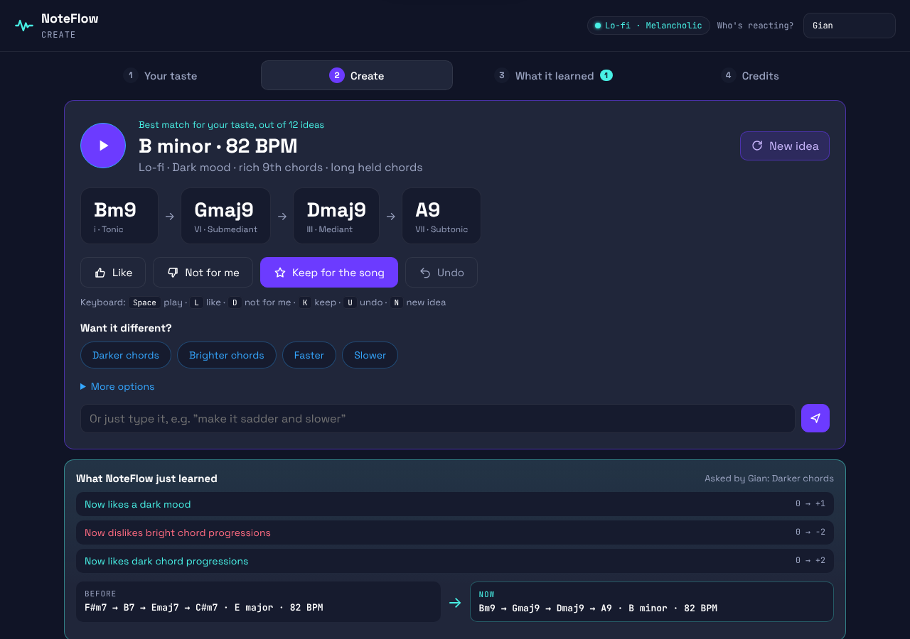

# NoteFlow

An AI co-writer for musicians. It starts from your taste, suggests chord progressions, song structures and lyric sketches, learns from every reaction, shows exactly what it learned, and drafts the split sheet for your collaborators.

**Live demo:** https://noteflow-j8af.onrender.com (click **Try a quick demo** to start in one click)



| | |
| --- | --- |
| **Hackathon** | State of the Art Hackathon 2026 (BASIX.MARKET) |
| **Track** | 02 Builders, MeTTa Foundation (Level 1) |
| **Challenge** | 2. The Agent That Grows Up: "Start with a small rule set and show it learning visibly. Show the diff." |
| **Partner brief** | Incantio: "a composing agent that learns a style and writes the split sheet" (a proposal until Incantio confirms it) |

## The problem

Musicians struggle to grow ideas in their own style, and co-writers rarely write down who did what. NoteFlow learns a musician's taste from their reactions, explains every choice, and keeps a record of who kept which idea so the team can agree on splits early.

## How it works

1. **Your taste.** Pick a genre, a mood and a tempo. MeTTa turns them into about 7 starting rules.
2. **Create.** NoteFlow writes 12 ideas (4 chords, a song structure, a lyric sketch), scores each one in MeTTa and plays the best. About 15% of the time it tries something new so it can keep learning.
3. **React.** Like, Not for me, Keep for the song, a change like "Darker chords", or a typed request like "make it sadder and slower". **Undo** takes back the last reaction.
4. **What it learned.** Every reaction changes the MeTTa rules. NoteFlow shows each change in plain words ("Now likes dark chord progressions"), the idea before and after, and the full rule diff under "Under the hood". The next idea follows what you asked for.
5. **Credits.** Collaborators enter their own roles and shares. NoteFlow never assigns shares. MeTTa checks the total is 100%, and the sheet stays a draft until everyone ticks "Agreed". Download as Markdown or print to PDF.

It is also built to be easy to use: one-click demo, keyboard shortcuts (<kbd>Space</kbd> play, <kbd>L</kbd> like, <kbd>D</kbd> not for me, <kbd>K</kbd> keep, <kbd>U</kbd> undo, <kbd>N</kbd> new idea), labelled controls for screen readers, large tap targets on phones, and reduced motion when the system asks for it.

## How MeTTa is used

The learning is rule-based: preferences are MeTTa atoms like `(pref progression dark 2)`, and feedback adds, strengthens, weakens or removes them.

| File | Role |
| --- | --- |
| `metta/hints.metta` | How a genre or mood becomes starting rules |
| `metta/logic.metta` | `setup`, `score`, `stance`, `rate`, `request` and `nudge` (learning with `remove-atom` and `add-atom`) |
| `metta/changes.metta` | What each change request does, plus keywords for typed requests |
| `metta/splits.metta` | Contribution roles, and `total` / `split-status` to check shares add up to 100% |

Example: start as Lo-fi, Melancholic, 82 BPM, then ask for "Darker chords". The rule diff is:

```diff
+ (pref mood dark 1)
+ (pref progression bright -2)
+ (pref progression dark 2)
+ (dislikes progression bright)
+ (likes mood dark)
+ (likes progression dark)
```

The next idea is in a minor key with a dark progression, and "Why NoteFlow picked this" says the request shaped it.

## Run it locally

Requires **Python 3.10, 3.11 or 3.12** (the `hyperon` package has no wheels for 3.13 yet).

```bash
python -m venv .venv
.venv\Scripts\activate          # macOS / Linux: source .venv/bin/activate
pip install -r requirements.txt
python app.py                   # then open http://127.0.0.1:5000
pytest                          # 19 tests
```

On Windows with several Python versions installed, create the environment with `py -3.12 -m venv .venv`.

## Deploy

`render.yaml` deploys the app to Render's free plan: sign in at render.com with GitHub, click **New → Blueprint**, pick this repo and click **Apply**. Each visitor gets their own agent, kept by a browser cookie. `.github/workflows/keep-awake.yml` visits the live demo every 10 minutes so the free server doesn't fall asleep.

## Project structure

```
app.py            Flask API, one agent per visitor
agent.py          MeTTa wrapper: setup, scoring, learning, undo, history, split check
composer.py       Chords, voicings, song structures and lyric sketches
metta/            MeTTa rules and logic
static/           Web app (HTML, CSS, JavaScript, Web Audio playback)
tests/            pytest tests
docs/             Screenshot
render.yaml       Render deployment settings
```

## Data and rights

All chords, structures and lyrics are generated from built-in music rules and word lists. No Incantio, AI for Peace, HFAS or Harlem CLxR data is used. The split sheet is not legal advice and is final only when every collaborator signs. The AI is disclosed and gets no share.

## What's next

- Learn combinations (for example "minor + slow") and melodies, not just single features.
- Export MIDI and stems with metadata, ready to list on Incantio.
- One profile per musician, plus a shared band profile.
- Send signed splits to Incantio once the partner confirms the integration.

## Team

- Gerard Norielle Opsima (lead)
- Rufert Concepcion
- michaeledwin2004

## AI disclosure

See [AI_DISCLOSURE.md](AI_DISCLOSURE.md).
